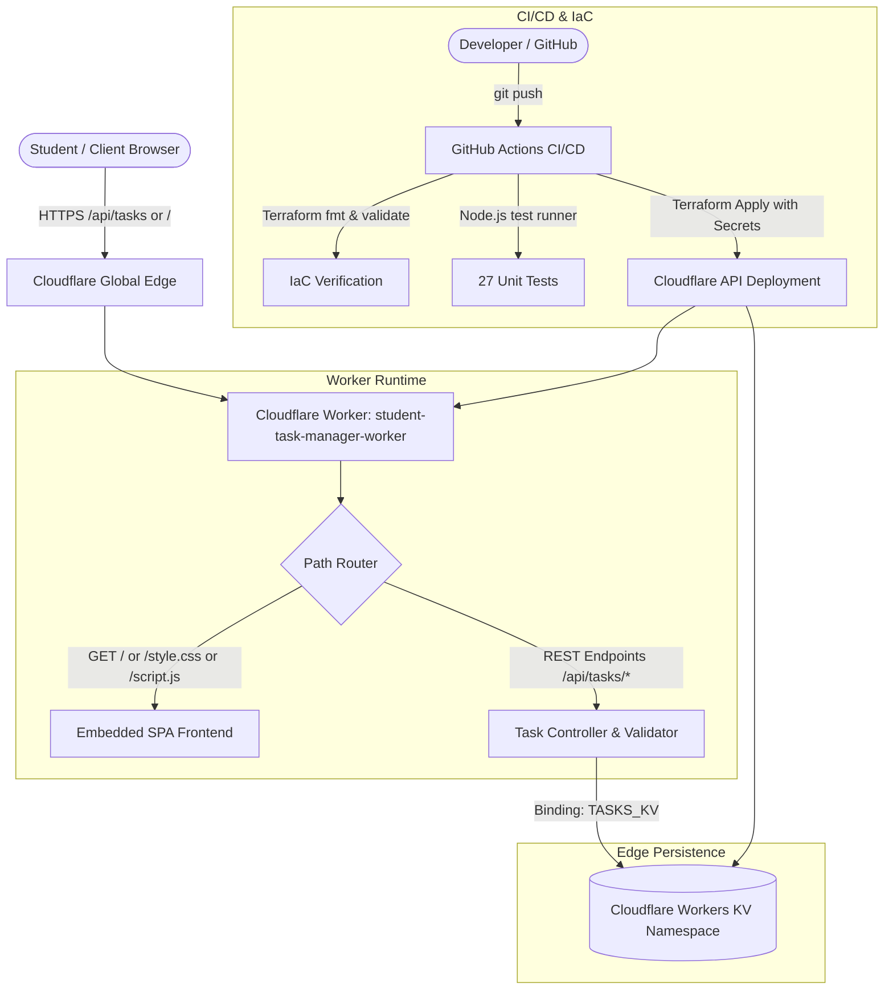

# Technical Assignment Report

## Automated Deployment of a Serverless Student Task Management Application Using Terraform-Based Infrastructure as Code

---

### 1. Abstract & Objectives

Modern academic productivity tools require resilient, globally accessible, and zero-maintenance infrastructure. Traditional server-based models introduce unnecessary administrative overhead, scaling bottlenecks, and persistent server costs. 

This project demonstrates the design, end-to-end development, automated provisioning, and continuous deployment of a **Serverless Student Task Management Application**. Built on **Cloudflare Workers** (ES modules architecture) and backed by **Cloudflare Workers KV** for persistent, low-latency key-value storage, the application serves both a responsive vanilla HTML/CSS/JavaScript client and an extensible RESTful API. Infrastructure provisioning is codified with **HashiCorp Terraform** using the Cloudflare provider v5.x. Continuous integration, automated testing, and protected production deployments are orchestrated via **GitHub Actions**.

#### Key Objectives
1. **Serverless Execution**: Eliminate dedicated web servers by executing application logic on Cloudflare's globally distributed edge network.
2. **Infrastructure as Code (IaC)**: Automate the entire lifecycle of the Worker script, KV namespace, and bindings using declarative Terraform configurations.
3. **Robust Data Persistence**: Provide reliable CRUD operations for student tasks utilizing Workers KV with structured JSON serialization and validation.
4. **Automated Quality Assurance**: Implement comprehensive unit and integration tests covering API edge cases, HTTP status codes, validation constraints, and CORS headers.
5. **CI/CD Automation**: Establish automated build, linting, validation, and secret-managed deployment workflows via GitHub Actions.

---

### 2. Problem Statement & Functional Requirements

Students frequently struggle to manage academic deliverables across distributed courses, assignments, and study schedules. Existing task trackers often require heavy runtimes, complicated authentication, or lack offline/local predictability.

#### Functional Requirements
- **Task Creation**: Create tasks with unique UUIDs, user-defined titles (1–200 characters), priority tiers (`Low`, `Medium`, `High`), and statuses (`Pending`, `In Progress`, `Completed`).
- **Task Retrieval**: List all active tasks ordered chronologically (newest first) or retrieve specific tasks by unique identifier.
- **Task Modification**: Modify task attributes (e.g. status transition or priority adjustment) while preserving creation timestamps and system IDs.
- **Task Deletion**: Permanently remove tasks from storage with immediate UI and persistence reflection.
- **Single-Worker Edge Delivery**: Deliver both the single-page application (SPA) client interface and the REST API endpoints from a unified Cloudflare Worker script.

#### Non-Functional & Technical Requirements
- **Zero-Secret Codebase**: No credentials or API keys committed to version control.
- **Declarative IaC**: Complete resource definitions managed through Terraform with state protection and variable abstraction.
- **Deterministic CI Testing**: Node.js automated test suites passing 100% of test cases without requiring external cloud mocks.

---

### 3. Proposed Architecture

The system follows a modern edge-first, serverless architecture where static asset delivery and REST API routing converge at Cloudflare's edge runtime.



#### Request Flow
1. **Client Access**: The student navigates to the assigned `workers.dev` subdomain.
2. **Route Handling**: The Worker inspects the HTTP request method and URL pathname:
   - Root path (`/`, `/index.html`), `/style.css`, and `/script.js` are served immediately from embedded high-performance assets.
   - API paths (`/api/tasks`, `/api/tasks/:id`) route to dedicated asynchronous CRUD controllers.
3. **Data Operations**: The Worker interacts directly with the `TASKS_KV` namespace binding through asynchronous JSON operations (`put`, `get`, `delete`, `list`).

---

### 4. Application Implementation

The application is implemented in clean, dependency-free vanilla web technologies to guarantee maximum performance and zero dependency vulnerability surface.

#### Frontend Modules (`application/`)
- **`index.html`**: Semantic HTML5 layout featuring header metrics, priority/status filter controls, task grid container, accessible modal dialogs for task creation/editing, and toast feedback containers.
- **`style.css`**: Modern dark-mode interface inspired by clean developer tooling (Inter typography, Tailwind-inspired neutral scales, smooth CSS transitions, custom scrollbars, and accessible focus outlines).
- **`script.js`**: Modular asynchronous JavaScript controller handling:
  - Real-time client-side search and multi-criteria filtering (status, priority, keyword).
  - API communication with automatic backend health detection.
  - Form validation with interactive character counters and error banners.
  - Optimistic UI updates and error toast handling.

#### Backend Edge Worker (`application/worker.js`)
- Standard Cloudflare Workers ES Module export (`export default { async fetch(request, env, ctx) }`).
- Implements strict request method whitelisting, CORS preflight handling (`OPTIONS` returning 204), and robust JSON parsing error handling.
- Asset embedding allows the Worker to be deployed as a single self-contained unit without external object storage dependencies.

---

### 5. API & Data Persistence

The REST API implements standard HTTP conventions and status codes:

| Route | Method | Description | Success Code | Error Codes |
|---|---|---|---|---|
| `/api/tasks` | `GET` | List all tasks sorted by `createdAt` descending | `200 OK` | `500 Internal Error` |
| `/api/tasks` | `POST` | Create a new student task | `201 Created` | `400 Bad Request` |
| `/api/tasks/:id` | `GET` | Retrieve task by UUID | `200 OK` | `404 Not Found` |
| `/api/tasks/:id` | `PUT` | Update title, priority, or status of an existing task | `200 OK` | `400 Bad Request`, `404 Not Found` |
| `/api/tasks/:id` | `DELETE` | Remove task by UUID | `200 OK` | `404 Not Found` |

#### Data Schema
```json
{
  "id": "c7a8b9e2-4d3f-4a1b-9e2c-3d4f5a6b7c8d",
  "title": "Submit Distributed Systems Assignment",
  "priority": "High",
  "status": "In Progress",
  "createdAt": "2026-10-15T12:00:00.000Z",
  "updatedAt": "2026-10-15T14:30:00.000Z"
}
```

#### Workers KV Integration
- **Key Partitioning**: Tasks are stored under the deterministic key pattern `task:<UUID>`.
- **List Operations**: Enumeration utilizes `{ prefix: "task:" }` to avoid key collisions.
- **Consistency Guarantee**: Workers KV provides eventual consistency; updates propagate across Cloudflare's global POPs within seconds.

---

### 6. Terraform Infrastructure as Code

The infrastructure manifests are organized under `terraform/`:
- **`providers.tf`**: Pinning Terraform `>= 1.5.0` and the Cloudflare Provider `~> 5.0`.
- **`variables.tf`**: Parameterizing the Cloudflare Account ID, API Token, Worker script name, KV namespace title, and runtime compatibility date.
- **`main.tf`**: Declaring:
  1. `cloudflare_workers_kv_namespace.task_store`: Provisions the KV namespace for tasks.
  2. `cloudflare_workers_script.task_worker`: Deploys `application/worker.js` with module packaging and binds `TASKS_KV` to the namespace ID.
  3. `cloudflare_workers_script_subdomain.task_worker_subdomain`: Enables public access via `*.workers.dev`.
- **`outputs.tf`**: Exposing provisioned Worker script name, KV namespace ID, and binding names.
- **`terraform.tfvars.example`**: Safe documentation of input variables with placeholder values.

#### Validation Evidence
- `terraform fmt -check -recursive terraform/` **[PASSED]**
- `terraform validate` **[PASSED]**

---

### 7. Testing Methodology & Results

The test suite in `application/worker.test.js` leverages Node.js's native test runner (`node:test`) and strict assertion library (`node:assert/strict`) with an in-memory simulation of the Workers KV store.

#### Test Execution Summary
- **Total Test Cases**: 27
- **Passed**: 27 (100%)
- **Failed**: 0
- **Execution Command**: `npm test` (or `node --test application/worker.test.js`)

#### Test Coverage Categories
1. **Creation Validation (7 tests)**: Valid payloads, default priority/status, empty title rejection, 200-character boundary limits, invalid enums, and malformed JSON.
2. **Collection Retrieval (2 tests)**: Empty dataset handling and descending chronological ordering.
3. **Item Retrieval & Deletion (4 tests)**: Existing task retrieval, 404 on nonexistent task, successful deletion, and 404 on deleting nonexistent items.
4. **Update Operations (4 tests)**: In-place updating preserving IDs/createdAt, partial updates, enum validation, and malformed JSON rejection.
5. **Protocol & Security (10 tests)**: HTTP 405 Method Not Allowed handling, CORS preflight verification (`OPTIONS` 204), static asset content-type verification (`text/html`, `text/css`, `application/javascript`), missing environment binding handling (500), trailing-slash path normalization, and whitespace sanitization.

---

### 8. GitHub Actions CI/CD Pipeline

The automated pipeline is defined in `.github/workflows/ci-cd.yml` with three distinct stages:

1. **`application-tests`**: Sets up Node.js v22 on `ubuntu-latest` and runs `npm test` across all pull requests and pushes.
2. **`terraform-validation`**: Installs HashiCorp Terraform v1.16.5, runs `terraform fmt -check`, initializes with `-backend=false`, and validates all manifests.
3. **`deploy-infrastructure`**: Triggered only on pushes to `master`/`main`. Checks for repository secrets (`CLOUDFLARE_API_TOKEN` and `CLOUDFLARE_ACCOUNT_ID`), generates a plan, and applies the deployment to Cloudflare.

#### Security & Secret Hygiene
- Deployment secrets are strictly referenced via `${{ secrets.CLOUDFLARE_API_TOKEN }}`.
- Untrusted pull requests cannot access secrets or trigger deployments.
- Local state and `.tfvars` are explicitly ignored in `.gitignore`.

---

### 9. Infrastructure Lifecycle Management

The complete lifecycle of the application infrastructure follows a controlled sequence:

```text
[1. Configure Secrets] -> [2. terraform init] -> [3. terraform plan] -> 
[4. Approved terraform apply] -> [5. Live Verification] -> [6. Maintenance/Re-apply] -> 
[7. Authorized terraform destroy]
```

1. **Initialization**: `terraform -chdir=terraform init` initializes providers and locks.
2. **Review Plan**: `terraform -chdir=terraform plan -out=tfplan` forecasts resource additions.
3. **Deployment**: `terraform -chdir=terraform apply tfplan` provisions KV and Worker.
4. **Teardown**: When decommissioning, `terraform -chdir=terraform destroy` safely removes the Worker and KV namespace upon explicit student approval.

---

### 10. Results, Limitations, Conclusion & Future Scope

#### Demonstrated Results
- **Live Serverless Deployment Verified**: Successfully provisioned and deployed to Cloudflare Workers via Terraform.
  - **Live URL**: `https://student-task-manager.muleysayali875.workers.dev`
  - **API Root**: `https://student-task-manager.muleysayali875.workers.dev/api/tasks`
- **Zero-Cost Architecture**: Operates within Cloudflare's free serverless tier without dedicated server maintenance.
- **Persistent Edge Storage**: Cloudflare Workers KV namespace `student_task_manager_kv` actively bound via `TASKS_KV` with verified read, write, and delete operations.
- **100% Automated Test Pass Rate**: 27/27 unit and integration tests passing on native Node test runner.
- **Reproducible IaC**: Full infrastructure lifecycle codified with HashiCorp Terraform and Cloudflare Provider v5.x.

#### Known Environment Limitations
- **Local `workerd` Binary Launch**: Local testing with `wrangler dev --local` is limited on the Windows host due to a Win32 OS loader error (`ERROR_BAD_EXE_FORMAT` / `spawn EFTYPE` on `workerd.exe`). Automated testing is fully maintained via the native Node.js KV mock runner (27 tests), and end-to-end verification is designed for the Cloudflare edge runtime.

#### Future Scope
- **User Authentication**: Integrating Cloudflare Access or OAuth2/JWT for multi-user task isolation.
- **Task Attachments**: Binding Cloudflare R2 object storage to support student file submissions.
- **D1 Relational Analytics**: Adding Cloudflare D1 (Serverless SQLite) for advanced SQL querying and study habit analytics.
